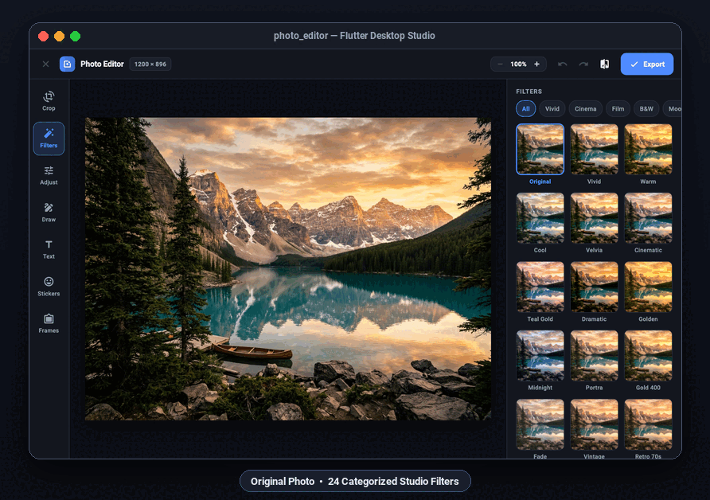
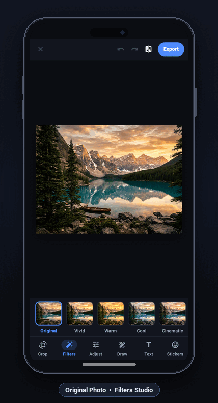

# photo_editor

A modern & professional Flutter photo editor library for editing images with **filters**, **cropping**, **adjustments**, **vector markup**, **text**, and **stickers** across **Android, iOS, macOS, Windows, Linux, and Web (WASM)** — with **zero external runtime dependencies**.

[](https://pub.dev/packages/photo_editor)
[](https://pub.dev/packages/photo_editor/score)
[](https://github.com/andikpbw/flutter-photo-editor/blob/main/LICENSE)
[](https://humanize.id)

---

## Live UI Showcase

`photo_editor` automatically adapts between a sleek **3-pane Desktop Studio** (left navigation rail, expansive zoomable canvas, right precision inspector) and a thumb-friendly **Mobile Studio** layout, in both Dark and Light themes.

### Desktop Studio Frame

<p align="center">
  
</p>

### Mobile Frame

<p align="center">
  
</p>

---

## Key Features

| Category | Capabilities |
| --- | --- |
| **Color Filters** | 16 built-in studio color-grading presets (`Vivid`, `Warm`, `Cool`, `Cinematic`, `Dramatic`, `Golden`, `Mono`, `Noir`, `Silver`, `Fade`, `Vintage`, `Nordic`, `Pastel`, `Sepia`, `Cyber`, `Original`), live thumbnail previews, adjustable filter intensity (`0–100%`), plus custom 4×5 matrix filter support. |
| **Precision Adjustments** | Real-time **Brightness**, **Contrast**, **Saturation**, **Exposure**, **Warmth**, **Tint**, **Fade**, **Clarity**, **Radial Vignette**, and resolution-scaled **Gaussian Blur** with tabular readouts and double-tap reset. |
| **Crop & Transform** | Interactive 8-handle + interior drag crop overlay with rule-of-thirds grid, live output dimension badge, aspect ratio presets (`Free`, `Original`, `1:1`, `4:3`, `3:2`, `16:9`, `4:5`, `9:16`), 90° left/right rotation, horizontal/vertical flip, and `-45°` to `+45°` fine straightening with automatic corner-fill zoom. |
| **Drawing & Markup** | Smooth quadratic Bézier **Pen**, semi-transparent **Highlighter**, vector **Arrow**, **Rectangle**, and **Oval** tools with customizable color swatches, width, and opacity stored in resolution-independent normalized coordinates. |
| **Text & Stickers** | Multi-line styled **Text** overlays (`Plain`, `Solid`, `Glass`, `Outline` pills, bold/italic, alignment, color swatches) and **Stickers** with direct drag, pinch/corner scale & rotate handles, duplication, and layer management. |
| **Non-Destructive Engine** | Full **Undo / Redo** stack with gesture coalescing, **Before / After Compare Original**, full JSON state serialization (`toJson` / `fromJson`), and interactive pinch/button zoom & pan. |
| **Zero-Dependency Export** | Pixel-identical WYSIWYG export pipeline supporting lossless **PNG**, built-in pure-Dart baseline **JPEG** (`quality: 1..100`), and **Raw RGBA**, with optional `maxWidth` / `maxHeight` downscaling across all 6 Flutter platforms including Web/WASM. |
| **Theming & i18n** | Built-in `PhotoEditorTheme.dark()` and `PhotoEditorTheme.light()`, custom accent colors, and full `PhotoEditorLabels` localization support. |

---

## Installation

Add `photo_editor` to your `pubspec.yaml`:

```yaml
dependencies:
  photo_editor: ^1.0.0
```

Or install via CLI:

```bash
flutter pub add photo_editor
```

---

## Quick Start

### 1. Open as a Full-Screen Route

The fastest way to integrate `photo_editor` is `PhotoEditor.open`, which returns a `PhotoEditorResult?` (`null` if cancelled):

```dart
import 'dart:typed_data';
import 'package:flutter/material.dart';
import 'package:photo_editor/photo_editor.dart';

Future<void> editPhoto(BuildContext context, Uint8List imageBytes) async {
  final PhotoEditorResult? result = await PhotoEditor.open(
    context,
    bytes: imageBytes,
    config: PhotoEditorConfig(
      theme: PhotoEditorTheme.dark(accentColor: const Color(0xFF4F8BFF)),
      exportOptions: const PhotoExportOptions(
        format: PhotoExportFormat.jpeg,
        jpegQuality: 92,
        maxWidth: 2048,
      ),
    ),
  );

  if (result != null) {
    // result.bytes  -> Uint8List (PNG / JPEG / Raw RGBA)
    // result.width  -> Exported pixel width
    // result.height -> Exported pixel height
    // result.state  -> Non-destructive PhotoEditState (serializable via toJson())
  }
}
```

### 2. Embed Directly in Your Widget Tree

You can embed `PhotoEditor` from memory bytes, any `ImageProvider` (`AssetImage`, `NetworkImage`, `MemoryImage`), or a pre-decoded `ui.Image`:

```dart
PhotoEditor.provider(
  const AssetImage('assets/sample.jpg'),
  config: PhotoEditorConfig(
    theme: PhotoEditorTheme.light(),
    tools: const <PhotoEditorTool>[
      PhotoEditorTool.crop,
      PhotoEditorTool.filters,
      PhotoEditorTool.adjust,
      PhotoEditorTool.draw,
      PhotoEditorTool.text,
      PhotoEditorTool.stickers,
    ],
  ),
  onComplete: (PhotoEditorResult result) {
    // Handle exported bytes & edit state
  },
  onCancel: () => Navigator.of(context).pop(),
)
```

### 3. Headless / Programmatic Editing & JSON State Persistence

Save drafts or apply edits programmatically without displaying the UI using `PhotoEditorController` and `PhotoExportEngine`:

```dart
final controller = PhotoEditorController()
  ..selectFilter(PhotoFilters.cinematic)
  ..setFilterIntensity(0.85)
  ..setAdjustment(PhotoAdjustmentType.contrast, 0.20)
  ..setAdjustment(PhotoAdjustmentType.vignette, 0.35)
  ..addTextLayer(text: 'Golden Hour');

// Persist non-destructive edit state as JSON
final Map<String, dynamic> savedDraft = controller.state.toJson();

// Restore later
final restoredState = PhotoEditState.fromJson(savedDraft);

// Export headless at full resolution
final PhotoEditorResult exported = await PhotoExportEngine.export(
  image: decodedUiImage,
  state: restoredState,
  options: const PhotoExportOptions(
    format: PhotoExportFormat.png,
  ),
);
```

### 4. Custom Color Filters & Localization

```dart
const customFilter = PhotoFilter(
  id: 'emerald_film',
  name: 'Emerald',
  matrix: <double>[
    0.92, 0.04, 0.00, 0, -4,
    0.00, 1.12, 0.02, 0,  4,
    0.00, 0.06, 1.04, 0,  6,
    0.00, 0.00, 0.00, 1,  0,
  ],
);

final config = PhotoEditorConfig(
  filters: <PhotoFilter>[...PhotoFilters.presets, customFilter],
  labels: const PhotoEditorLabels(
    title: 'Editor Foto',
    done: 'Simpan',
    cancel: 'Batal',
    cropTab: 'Potong',
    filtersTab: 'Filter',
    adjustTab: 'Sesuaikan',
    drawTab: 'Gambar',
    textTab: 'Teks',
    stickersTab: 'Stiker',
  ),
);
```

---

## Desktop & Web Keyboard Shortcuts

| Shortcut | Action |
| --- | --- |
| `Cmd / Ctrl + Z` | Undo |
| `Cmd / Ctrl + Shift + Z` or `Ctrl + Y` | Redo |
| `Cmd / Ctrl + 0` | Reset zoom to 100% (Fit) |
| `Delete` / `Backspace` | Delete selected text or sticker overlay |
| `Escape` | Clear overlay selection |

---

## Support

This library is proudly supported by **[Humanize AI](https://humanize.id)**.

If you find `photo_editor` useful for your Flutter projects, please star the repository on [GitHub](https://github.com/andikpbw/flutter-photo-editor), file issues or feature requests in the [issue tracker](https://github.com/andikpbw/flutter-photo-editor/issues), and visit [Humanize AI](https://humanize.id).

---

## License

Released under the [MIT License](https://github.com/andikpbw/flutter-photo-editor/blob/main/LICENSE).
